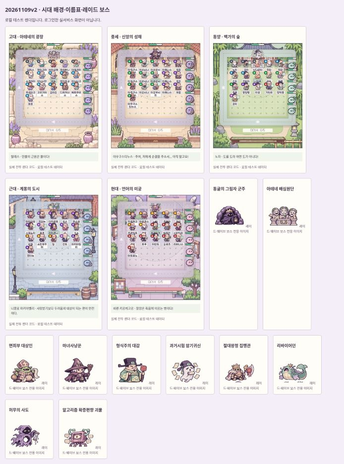
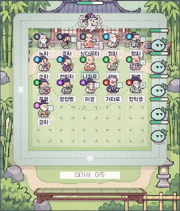
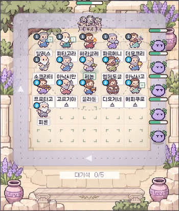
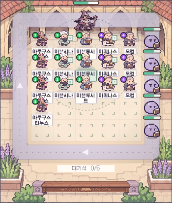
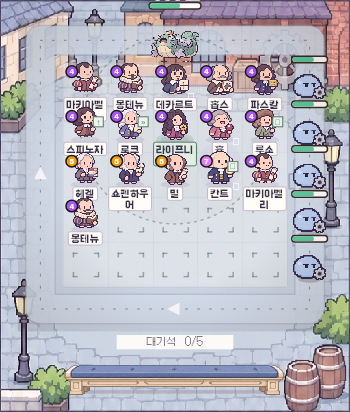
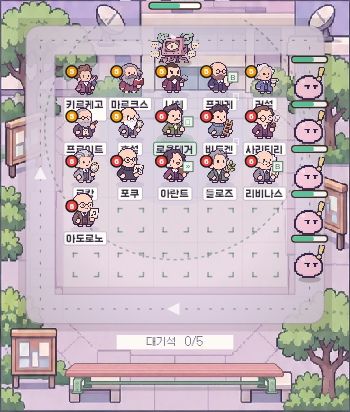

# 로컬 시각 검수 · 20261109v2

실제 전투 코드를 로컬 테스트 데이터로 렌더한 비교 자료다. 로그인한 실서비스 화면은 아니다. 배경·보스·이름표의 밀집 상태를 비교했다.

## 동양 · 그리스 배경 누출 수정

## 시대별 전투

| 고대 | 중세 |
|---|---|
|  |  |

| 근대 | 현대 |
|---|---|
|  |  |

## 보스별 실루엣

| 시대 | 전반 보스 | 최종/레이드 보스 |
|---|---|---|
| 고대 |  |  |
| 중세 |  |  |
| 동양 |  |  |
| 근대 |  |  |
| 현대 |  |  |

가독성 판단: 이름·배지·도구가 작은 칸에서 동시에 보이면 여전히 정보량이 많다. 이름을 두 줄로 분리하고 말풍선·보스바를 밖으로 옮겼다. 전체 이름과 상세 스킬은 아래 정보창으로 확인한다. 25칸 전체와 실제 휴대폰 최저 높이 검수는 후속 확인이 필요하다.
