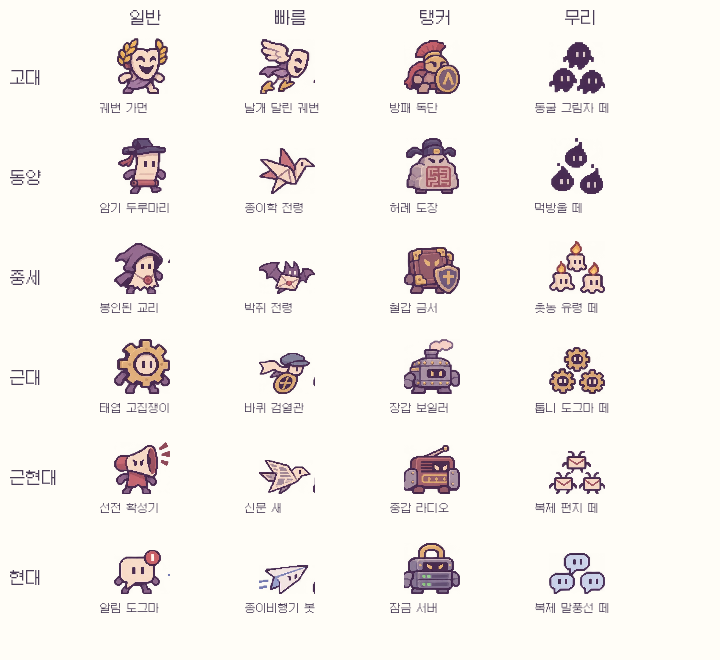
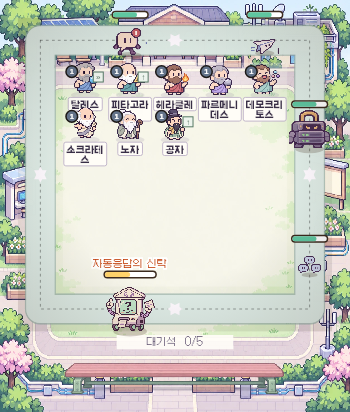

# 일반 몬스터와 현대 장 · 20261109v3

아래는 실제 게임의 이미지 분할·전투 렌더 코드를 로컬 테스트 데이터로 실행한 자료다. 로그인한 실서비스 캡처는 아니다.

## 6개 시대 × 4가지 역할

가로는 일반·빠름·탱커·무리, 세로는 고대·동양·중세·근대·근현대·현대다. 빠른 적의 날개/바퀴, 탱커의 방패/넓은 몸, 무리의 작은 3개 군집을 확인할 수 있다.

## 새 현대 전투

기존 근현대와 다른 민트색 광장에 알림, 비행기 봇, 잠금 서버, 말풍선 무리와 자동응답의 신탁을 배치한 테스트 화면이다.

[사건 4개·변경 사항·검증 결과](../RELEASE_20261109v3.md)
