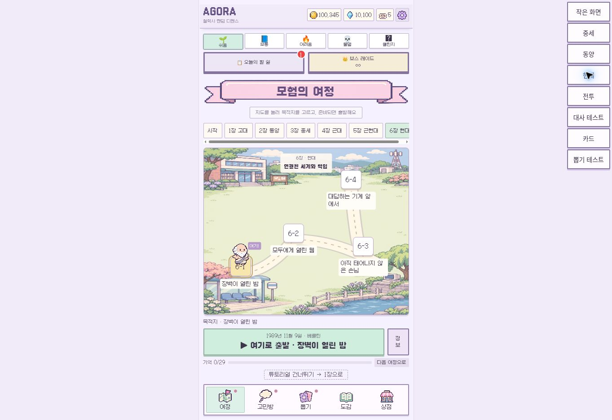
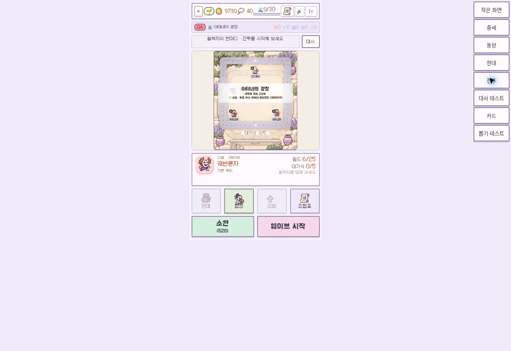
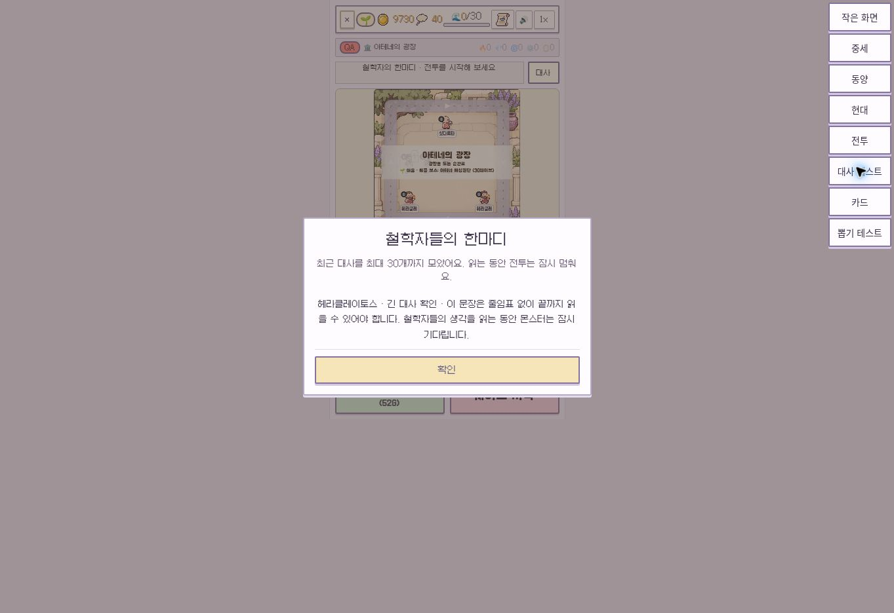
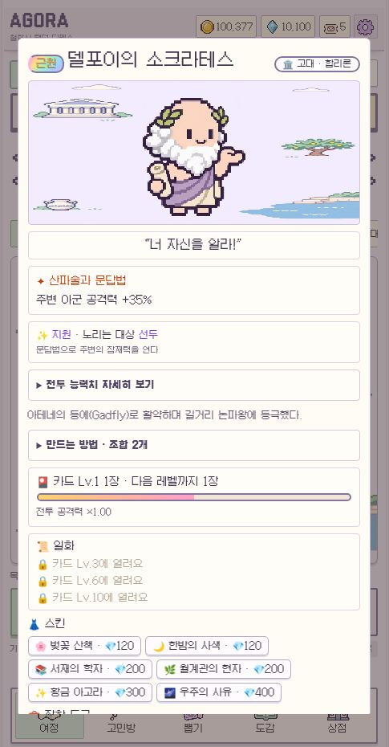
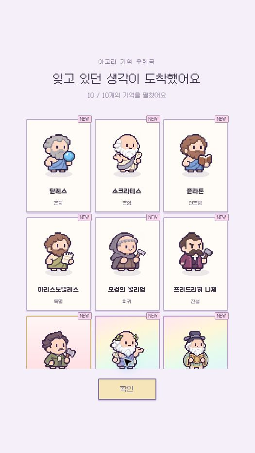

# 화면 검토 · 20261110v1

로컬 전용 테스트 계정과 고정 뽑기 결과로 찍은 브라우저 캡처다. 오른쪽 도구 버튼은 검수 도구이며 실서비스에 포함되지 않는다. 창 높이는 데스크톱이며 작은 전투 화면은 360×640 컨테이너로 확인했다.

## 현대 여정

이제 동양·중세 등의 장에서도 그리스 배경이 고정되지 않는다. 현대는 새 전용 풍경을 사용한다. 목적지 클릭 이동과 잠금 조건은 기존 동작을 유지한다.

## 작은 화면의 전투 — 결정 필요

하단 버튼은 들어오지만 짧은 화면에서는 7×7 전투판과 이름표가 여전히 작다. 최신 커밋의 한 줄 이름표를 보존했으며 이름을 더 줄이지 않았다. 다음 선택은 `행동 버튼을 접어 전투판 확대` 또는 `선택 캐릭터만 큰 이름표 표시`다. 추천은 상세 정보 패널을 선택했을 때만 크게 펼치는 방식이다. 이는 별도 UX 변경으로 남겼다.

## 긴 대사

대사를 읽는 동안 전투를 멈춘다. 한 줄 안내가 잘리더라도 전체 기록에서는 줄임표 없이 읽을 수 있다.

## 캐릭터 상세

스킬을 먼저 보여주고 능력치·조합법을 펼쳐 본다. 시대에 맞는 그림을 연결하고 테두리를 가볍게 했다. 스킨과 도구가 많아지면 하단 스크롤은 여전히 길다. 후속으로 성장/장착 탭을 분리할지 검토가 필요하다.

## 10회 뽑기

3열로 확대해 이름·캐릭터가 읽히게 했다. 결과 목록을 세로 스크롤하면 10장 모두 볼 수 있고 확인 버튼은 별도 영역에 남는다. 표시된 결과는 검수용이며 실제 확률이나 보상을 변경하지 않는다.
