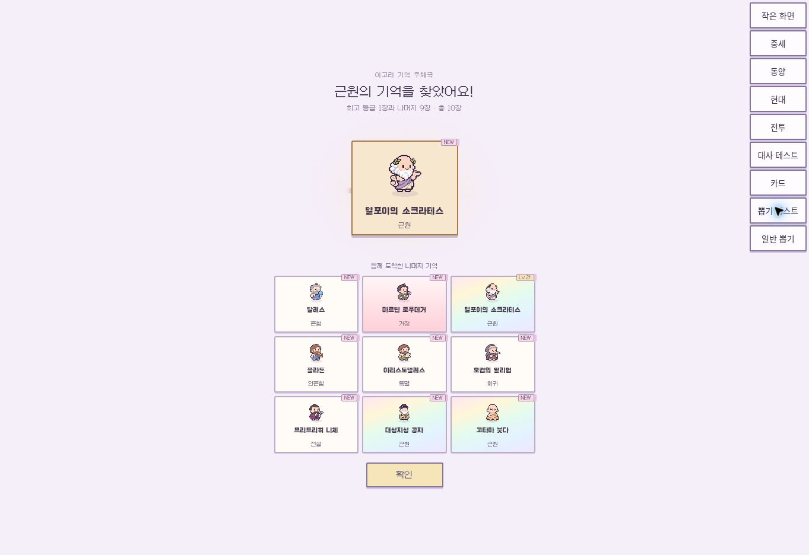
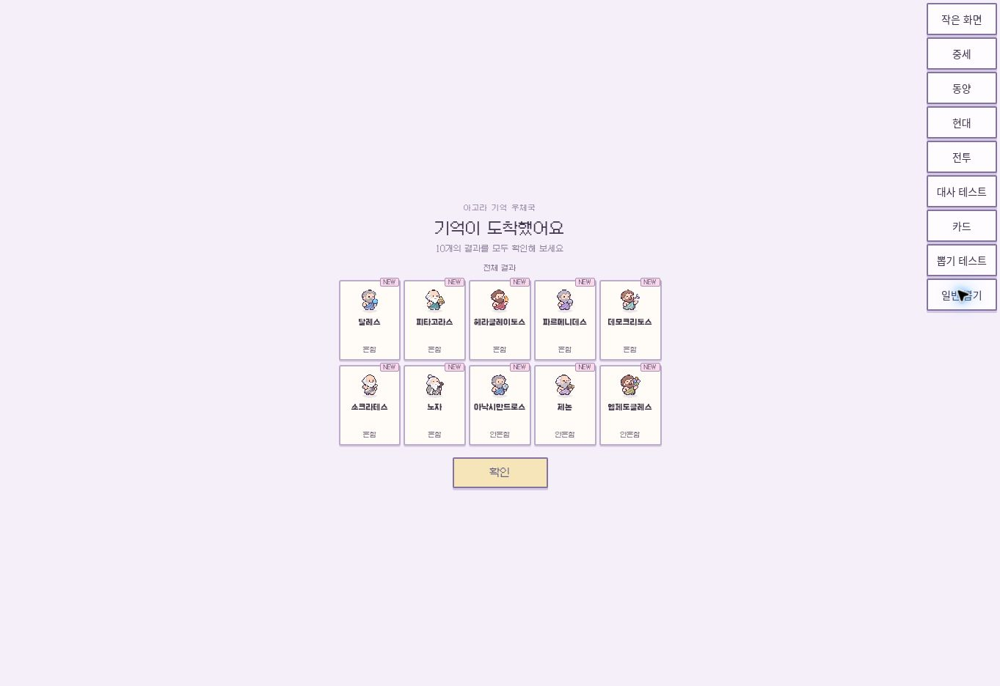

# 20261110v2 · 열 장 뽑기

전설 이상이 나오면 최고 등급 한 장을 중앙에서 봉인 → 뒤집기 → 공개합니다. 동급이면 최초 등장 카드를 강조합니다. 나머지 9장은 아래 3×3으로 함께 공개합니다.

전설 미만이면 기다림 없이 10장을 5×2로 공개합니다. 확률·보상·저장 구조는 변경하지 않았습니다.

캡처는 실제 UI 코드에 고정 결과를 넣은 로컬 검증 화면입니다. 오른쪽 개발용 버튼은 배포되지 않습니다. 자동 검증: 동급 우선순위, 중복 카드, 1+9 배치, 일반 열 장, 타이머, 건너뛰기, 단일 결과, 컬렉션 불변. 빌드 통과. 로그인 계정의 실제 결제·재화 차감 검증은 포함하지 않았습니다.

이전 버전: backup/pre-20261110v2.
