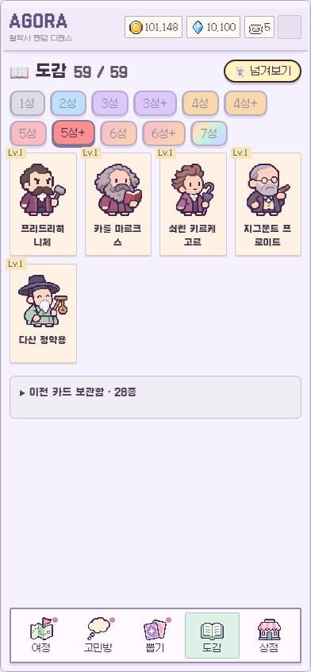
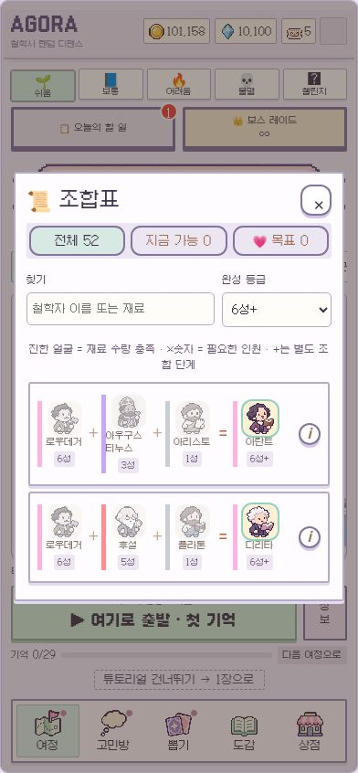
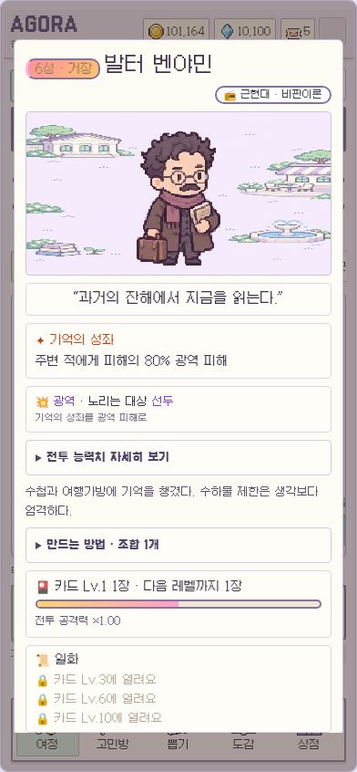

# 20261110v3 · 59장 조합 적용

활성 카드 59장 / 조합 52개 / 1성 7장 / 촉매 없는 조합. 이전 버전은 `backup/pre-20261110v3`에 보존합니다.

직전 설명의 하이데거 5성+ 배치는 니체 5성+를 재료로 쓸 수 없어 수정했습니다. 하이데거는 6성, 그를 사용하는 아렌트와 데리다는 6성+입니다. 마키아벨리를 억지로 추가해 60장을 채우지 않고 59장을 유지합니다.

## 화면

390×844 iframe에서 실제 앱 코드를 실행한 로컬 검증 화면입니다. 관리용 고정 결과를 사용했으며, 테스트 페이지와 버튼은 배포에 포함하지 않습니다. 실사용 계정에 로그인하거나 서버 저장을 덮어쓰지 않았습니다.

## 적용 내용

- 3성+·4성+·5성+·6성+를 독립된 조합 단계로 처리합니다. 전투 강화 +1과 구별합니다.
- 모든 재료 등급은 결과보다 엄격히 낮습니다. 근원 이외에는 설정된 대표 사상 시점도 결과보다 늦지 않습니다. 이것은 직접 영향 관계의 역사학적 검증을 뜻하지 않습니다.
- 1성부터 재귀 계산한 환산량을 조합 상세에 표시합니다. 5성은 14~18명분, 5성+는 18~32명분입니다. 근원은 사용자 제안 재료와 기억 해금에 따른 별도 경로여서 환산량이 균일하지 않습니다.
- 같은 재료는 ×수량으로 묶으며, 엔진에서는 실제 개별 철학자를 정확히 그 수만큼 소비합니다.
- 이름/재료 검색과 완성 등급 필터를 제공합니다. 이름이 같은 기본 카드와 근원 카드도 등급 표기로 구분합니다.
- 기존 80장 중 52장의 ID를 유지하고 7장을 추가했습니다. 빠지는 28장은 도감의 이전 카드 보관함에서 보유 수량을 확인할 수 있습니다. 기존 카드·경험치·최애·도구·스킨·재화·클리어 기록은 삭제하거나 다른 인물로 교환하지 않습니다. 활성 카드가 전혀 없는 저장에만 소크라테스 한 장을 보충합니다.
- 전투 소환은 1성 중심이며, 보유한 상위 카드도 낮은 확률로 등장합니다. 열린 등급끼리 정규화하며, 보유 근원은 첫 소환부터 등장할 수 있습니다. 튜토리얼은 지정 1성만 나옵니다.
- 카드 뽑기는 기존 성급 확률 총량을 유지하면서 +등급으로 나눴습니다. 고뇌는 열린 시대/보유 카드, 지혜석·초대장은 전체 시대입니다. 거장 천장은 열린 거장이 없을 때도 전체 시대에서 보장합니다.
- P4에서 소크라테스·비트겐슈타인, P7 붓다, P8 공자, P12 예수, P16 근원 칸트의 기억을 추가로 받습니다. 기존 클리어 계정은 재도전 보상 또는 뽑기로 얻을 수 있습니다.
- 새 인물과 근원 칸트를 위한 파스텔 캐릭터 아틀라스 8칸을 제작했습니다.

## 조합표

`검토` 표시는 직접 계승 전체를 뜻하지 않는 게임적 축약입니다. 임시 구성을 게임에 넣되, 수정이 필요한 항목을 남겼습니다.

| 등급 | 결과 | 직접 재료 | 1성 환산 | 검토 |
|---|---|---|---:|---|
| 1성 | 소크라테스 | 기본 소환 | 1 |  |
| 1성 | 플라톤 | 기본 소환 | 1 |  |
| 1성 | 아리스토텔레스 | 기본 소환 | 1 |  |
| 1성 | 데모크리토스 | 기본 소환 | 1 |  |
| 1성 | 공자 | 기본 소환 | 1 |  |
| 1성 | 노자 | 기본 소환 | 1 |  |
| 1성 | 싯다르타 | 기본 소환 | 1 |  |
| 2성 | 맹자 | 공자 ×2 | 2 |  |
| 2성 | 순자 | 공자 + 노자 | 2 | 게임적 축약 |
| 2성 | 장자 | 노자 ×2 | 2 |  |
| 2성 | 나가르주나 | 싯다르타 ×3 | 3 |  |
| 2성 | 플로티노스 | 플라톤 + 아리스토텔레스 | 2 |  |
| 2성 | 피론 | 소크라테스 + 데모크리토스 | 2 | 게임적 축약 |
| 2성 | 에피쿠로스 | 데모크리토스 ×2 | 2 |  |
| 2성 | 세네카 | 소크라테스 + 아리스토텔레스 | 2 | 게임적 축약 |
| 3성 | 아우구스티누스 | 플로티노스 + 소크라테스 ×2 | 4 |  |
| 3성 | 원효 | 나가르주나 + 싯다르타 ×2 | 5 |  |
| 3성 | 육구연 | 맹자 + 장자 | 4 | 게임적 축약 |
| 3성+ | 토마스 아퀴나스 | 아우구스티누스 + 아리스토텔레스 ×2 | 6 |  |
| 3성+ | 주희 | 맹자 + 공자 ×2 | 4 | 게임적 축약 |
| 3성+ | 오컴의 윌리엄 | 아우구스티누스 + 소크라테스 + 아리스토텔레스 | 6 | 게임적 축약 |
| 4성 | 르네 데카르트 | 아우구스티누스 + 피론 | 6 |  |
| 4성 | 존 로크 | 오컴의 윌리엄 + 아리스토텔레스 | 7 | 게임적 축약 |
| 4성 | 고트프리트 라이프니츠 | 플로티노스 + 아리스토텔레스 ×2 + 플라톤 ×2 | 6 | 게임적 축약 |
| 4성 | 바뤼흐 스피노자 | 플로티노스 + 아리스토텔레스 ×2 + 데모크리토스 ×2 | 6 | 게임적 축약 |
| 4성 | 블레즈 파스칼 | 아우구스티누스 + 세네카 | 6 |  |
| 4성 | 왕양명 | 육구연 + 맹자 | 6 |  |
| 4성 | 퇴계 이황 | 주희 + 공자 ×2 | 6 |  |
| 4성 | 데이비드 흄 | 피론 + 아리스토텔레스 ×2 + 소크라테스 ×2 | 6 | 게임적 축약 |
| 4성 | 장 자크 루소 | 육구연 + 순자 | 6 | 게임적 축약 |
| 4성 | 율곡 이이 | 주희 + 맹자 | 6 |  |
| 4성+ | 임마누엘 칸트 | 데이비드 흄 + 고트프리트 라이프니츠 | 12 |  |
| 4성+ | 제러미 벤담 | 데이비드 흄 + 에피쿠로스 | 8 |  |
| 4성+ | 고틀로프 프레게 | 고트프리트 라이프니츠 + 아리스토텔레스 ×2 | 8 |  |
| 5성 | 게오르크 헤겔 | 임마누엘 칸트 + 바뤼흐 스피노자 | 18 |  |
| 5성 | 아르투어 쇼펜하우어 | 임마누엘 칸트 + 플라톤 + 싯다르타 | 14 |  |
| 5성 | 에드문트 후설 | 르네 데카르트 + 고틀로프 프레게 + 아리스토텔레스 ×2 | 16 |  |
| 5성 | 버트런드 러셀 | 고틀로프 프레게 + 고트프리트 라이프니츠 | 14 |  |
| 5성 | 존 스튜어트 밀 | 제러미 벤담 + 존 로크 | 15 |  |
| 5성 | 페르디낭 드 소쉬르 | 고틀로프 프레게 + 오컴의 윌리엄 | 14 | 게임적 축약 |
| 5성+ | 프리드리히 니체 | 게오르크 헤겔 + 아르투어 쇼펜하우어 | 32 |  |
| 5성+ | 카를 마르크스 | 게오르크 헤겔 + 에피쿠로스 + 데모크리토스 | 21 |  |
| 5성+ | 쇠렌 키르케고르 | 게오르크 헤겔 + 아우구스티누스 + 소크라테스 ×2 | 24 |  |
| 5성+ | 지그문트 프로이트 | 아르투어 쇼펜하우어 + 플라톤 ×4 | 18 | 게임적 축약 |
| 5성+ | 다산 정약용 | 주희 + 왕양명 + 퇴계 이황 + 율곡 이이 + 공자 ×2 | 24 | 게임적 축약 |
| 6성 | 마르틴 하이데거 | 에드문트 후설 + 프리드리히 니체 + 아리스토텔레스 ×2 | 50 |  |
| 6성 | 자크 라캉 | 지그문트 프로이트 + 페르디낭 드 소쉬르 + 게오르크 헤겔 | 50 |  |
| 6성 | 미셸 푸코 | 프리드리히 니체 + 임마누엘 칸트 + 순자 | 46 | 게임적 축약 |
| 6성 | 질 들뢰즈 | 프리드리히 니체 + 바뤼흐 스피노자 + 데이비드 흄 | 44 |  |
| 6성 | 발터 벤야민 | 카를 마르크스 + 임마누엘 칸트 + 플라톤 ×3 | 36 | 게임적 축약 |
| 6성 | 존 롤스 | 임마누엘 칸트 ×2 + 존 로크 + 장 자크 루소 | 37 |  |
| 6성+ | 한나 아렌트 | 마르틴 하이데거 + 아우구스티누스 + 아리스토텔레스 | 55 |  |
| 6성+ | 자크 데리다 | 마르틴 하이데거 + 에드문트 후설 + 플라톤 | 67 |  |
| 7성 | 델포이의 소크라테스 | 소크라테스 ×3 + 쇠렌 키르케고르 ×2 + 블레즈 파스칼 | 57 |  |
| 7성 | 대성지성 공자 | 공자 ×3 + 주희 ×2 + 왕양명 ×2 | 23 |  |
| 7성 | 고타마 붓다 | 싯다르타 ×5 + 나가르주나 ×5 + 원효 ×3 | 35 |  |
| 7성 | 예수 | 아우구스티누스 ×2 + 토마스 아퀴나스 ×2 + 블레즈 파스칼 ×2 + 쇠렌 키르케고르 | 56 |  |
| 7성 | 루트비히 비트겐슈타인 | 고틀로프 프레게 ×2 + 버트런드 러셀 + 소크라테스 ×2 | 32 |  |
| 7성 | 쾨니히스베르크의 칸트 | 임마누엘 칸트 ×2 + 데이비드 흄 ×2 + 고트프리트 라이프니츠 ×2 | 48 |  |

## 원본 관리와 검증

`data/roster-v3.json`이 인물·조합·전투 프로필·전투 소환 확률의 원본입니다. `npm run data`가 런타임 JSON을 생성합니다. 기존 `data/agora_master.xlsx`는 이전 인물표를 보관하며, 스테이지/촉매의 원본으로 계속 사용합니다. 같은 항목을 두 파일에서 동시에 수정하지 마세요.

통과: `npm run build`, `node scripts/check-roster-v3.mjs`, `node scripts/check-skill-visuals.mjs`, `node scripts/check-modern-story.mjs`. 별도의 DOM 검증으로 59개 카드 상세, 11개 등급 탭, 검색과 필터, 13명 직접 재료의 묶음 표시, + 뽑기 우선순위, 전투 렌더링, 이전 최애가 있는 저장을 확인했습니다.

제한: 한 판의 클리어율·평균 완성 시간은 아직 실사용 플레이로 튜닝하지 않았습니다. 철학사 영향의 엄밀한 검토가 필요한 임시 조합은 위 표에 남겨 두었습니다. 근원의 시점은 사후 기억을 모으는 게임 규칙의 예외입니다.

## 이미지 제작 기록

내장 이미지 생성으로 `src/assets/characters-v3.webp`를 제작했습니다. 4열×2행 투명 아틀라스, 순서: 육구연·이이·일반 칸트·벤담 / 소쉬르·벤야민·롤스·근원 칸트. 프롬프트: cute B-grade indie pastel pixel-art SD philosopher sprites, full-body, equal cells with transparent gutters, muted cream/mauve/sage/blue-gray, no text, no borders, distinct historical clothes and small signature props; ordinary Kant navy coat, origin Kant ivory/lavender coat.
